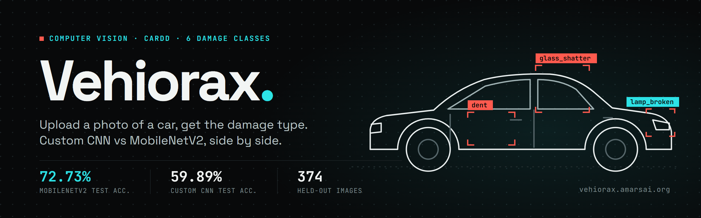
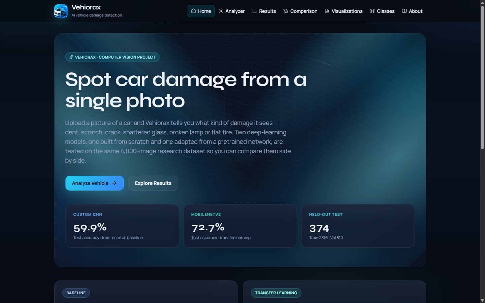
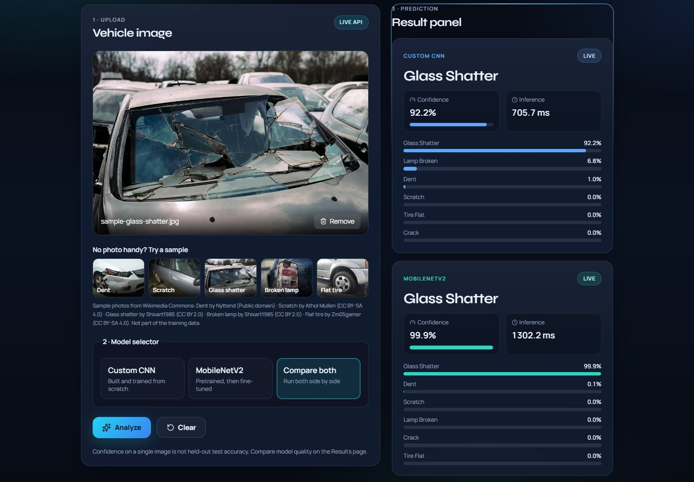
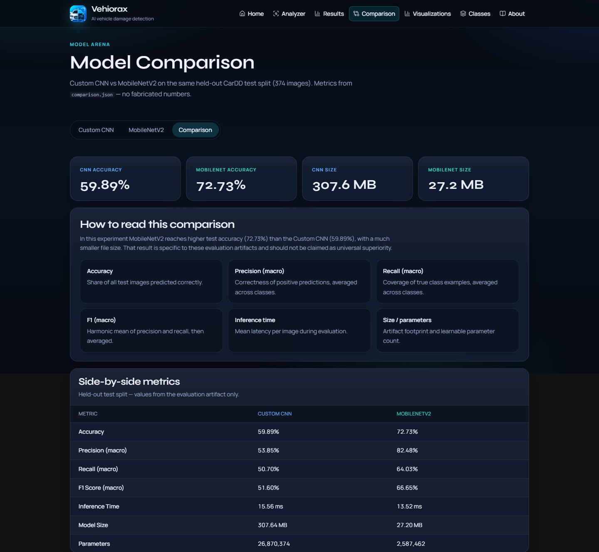
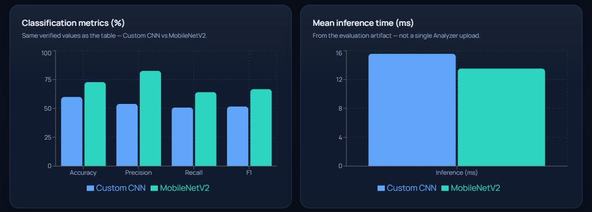
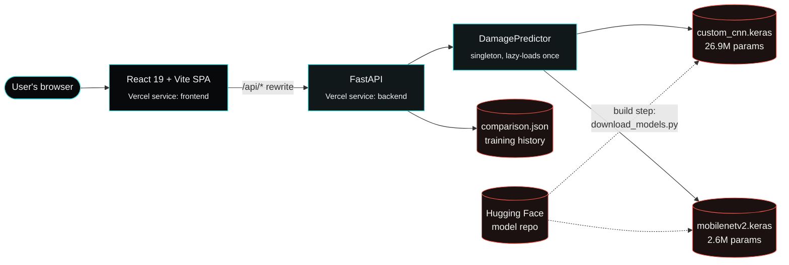
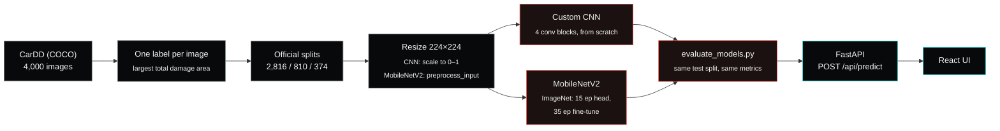

<div align="center">

<a href="https://vehiorax.amarsai.org"></a>

<br>

[](https://vehiorax.amarsai.org)
[](#-results)


**Upload a photo of a damaged car and get the damage type in about a second.**<br>
Two deep-learning models, trained on the same dataset and tested on the same 374 held-out images, compared side by side.

[**Try it live →**](https://vehiorax.amarsai.org) &nbsp;·&nbsp; [Results](#-results) &nbsp;·&nbsp; [How it works](#-ml-pipeline) &nbsp;·&nbsp; [Run locally](#-run-locally)

</div>

---

## 💡 Why

Insurance triage and garage estimates start with one question: *what kind of damage is this?* Public car-damage data is scarce. The **CarDD** research dataset (IEEE T-ITS 2023) gives six clean damage classes, which makes it a good way to answer a second question:

> **Is a small pretrained network better than a bigger network trained from scratch?**

Vehiorax trains both on identical splits, reports every metric honestly (including the weak classes), and serves both models live. Every number in the UI and in this README comes from the evaluation files in `ml/artifacts/evaluation/`. Nothing is made up.

## ✨ Features

| | |
|---|---|
| 🔍 **Damage Analyzer** | Drag in a photo or pick a sample. Run the Custom CNN, MobileNetV2, or **both side by side**. You get the predicted class, the confidence, all six class probabilities, and the inference time. |
| ⚖️ **Model Comparison** | Accuracy, macro precision, recall and F1, inference time, model size and parameter count, read from `comparison.json`. |
| 📈 **Visualizations** | Training curves, per-class F1 and confusion matrices for both models. |
| 🗂️ **Damage classes** | Dent · Scratch · Crack · Glass shatter · Lamp broken · Tire flat (the six official CarDD categories, with no invented "no damage" class). |
| 🛡️ **Honest failure states** | If a model file is missing the API answers `503 model not available` instead of guessing. Bad uploads get clear `413` / `415` / `400` errors. |
| ⚡ **Fast cold path** | Models load lazily once per process. Pages and three.js are code-split so the first load stays small. |

## 📸 Screenshots

<table>
<tr>
<td width="50%"><br><sub><b>Home</b>: the headline figures from the evaluation run</sub></td>
<td width="50%"><br><sub><b>Analyzer</b>: both models classify a sample as glass shatter</sub></td>
</tr>
<tr>
<td width="50%"><br><sub><b>Comparison</b>: side-by-side metrics on the 374-image test split</sub></td>
<td width="50%"><br><sub><b>Charts</b>: classification metrics and mean inference time</sub></td>
</tr>
</table>

## 🏗️ Architecture



One Vercel project runs two services. The SPA serves every route, and `/api/*` is rewritten to the FastAPI service. Model weights are too big for Git, so the backend build downloads them from Hugging Face.

## 🧠 ML pipeline



- **Labels:** CarDD images can show several damages. Each image gets the class with the largest total mask area, and the official train/val/test partitions are kept as they are.
- **Custom CNN:** 4 × (Conv-BN-ReLU ×2 → MaxPool → Dropout) with 32→64→128→256 filters, then Dense 512 → Softmax 6. Random initialisation.
- **MobileNetV2:** ImageNet backbone → GAP → Dense 256 → Softmax 6. The head is trained first with the base frozen, then the layers from 100 up are fine-tuned at a learning rate of 1e-4.
- **Training:** batch 32, Adam at 1e-3, early stopping (patience 10), ReduceLROnPlateau, best-checkpoint on validation accuracy, fixed seed 42.

## 📊 Results

Held-out CarDD test split: **374 images**, the same for both models.

| Metric | Custom CNN | **MobileNetV2** |
|---|---:|---:|
| Accuracy | 59.89% | **72.73%** |
| Precision (macro) | 53.85% | **82.48%** |
| Recall (macro) | 50.70% | **64.03%** |
| F1 (macro) | 51.60% | **66.65%** |
| Mean inference time | 15.56 ms | **13.52 ms** |
| Model size | 307.6 MB | **27.2 MB** |
| Parameters | 26,870,374 | **2,587,462** |

<details>
<summary><b>Per-class F1 (MobileNetV2 vs Custom CNN)</b></summary>

| Class | Test images | MobileNetV2 F1 | Custom CNN F1 |
|---|---:|---:|---:|
| Tire flat | 28 | 0.926 | 0.784 |
| Glass shatter | 65 | 0.915 | 0.806 |
| Scratch | 122 | 0.693 | 0.604 |
| Dent | 109 | 0.685 | 0.508 |
| Lamp broken | 42 | 0.559 | 0.394 |
| Crack | 8 | 0.222 | 0.000 |

</details>

**Takeaway:** in this experiment the pretrained MobileNetV2 is more accurate, a little faster, and about **11× smaller**. Crack is the weak spot for both models. It has only 94 images in the whole dataset and 8 in the test split, which is why the macro scores sit below accuracy.

## 🧰 Tech stack

| Layer | Tools |
|---|---|
| **ML** | TensorFlow / Keras, scikit-learn, NumPy, Pillow, Matplotlib, Seaborn |
| **API** | FastAPI, Uvicorn, Pydantic Settings, python-multipart |
| **Frontend** | React 19, TypeScript, Vite, Tailwind CSS 4, Motion, Recharts, three.js (react-three-fiber), react-dropzone |
| **Testing** | Pytest, Vitest |
| **Hosting** | Vercel (frontend and backend services in one project), Hugging Face (model weights) |

## 🗂️ Project structure

```text
├── backend/app/            FastAPI app: routes, schemas, prediction + visualization services
├── ml/
│   ├── models/             custom_cnn.py, mobilenetv2.py
│   ├── preprocessing/      dataset loader, preprocessing, split builder
│   ├── training/           train_custom_cnn.py, train_mobilenetv2.py
│   ├── evaluation/         evaluate_models.py, metrics, plots
│   ├── inference/          DamagePredictor
│   └── artifacts/          evaluation JSON, training history (weights are git-ignored)
├── frontend/src/           React pages, components, API client
├── scripts/                inspect / prepare dataset, download_models.py, run_ml.py
├── configs/default.yaml    classes, image size, training and fine-tune settings
├── tests/                  backend, ml and frontend tests
└── vercel.json             two-service deploy (frontend + backend)
```

## 🚀 Run locally

You need Python 3.10–3.12 (TensorFlow) and Node.js 18+. You **don't** need the dataset to run the app: the trained weights are downloaded for you.

```bash
git clone https://github.com/AmarSai01/vehicle-damage-detection.git
cd vehicle-damage-detection

# 1. Backend
python -m venv .venv
.venv\Scripts\activate          # macOS/Linux: source .venv/bin/activate
pip install -r requirements.txt
python scripts/download_models.py
uvicorn backend.app.main:app --reload --port 8000
```

```bash
# 2. Frontend (second terminal)
cd frontend
npm install
npm run dev                      # http://127.0.0.1:5173 (proxies /api to :8000)
```

API docs: `http://127.0.0.1:8000/docs`. The main endpoints are `GET /api/health`, `GET /api/models`, `GET /api/comparison` and `POST /api/predict` (multipart `file` plus `model` = `custom_cnn` | `mobilenetv2` | `both`).

<details>
<summary><b>Retrain from scratch</b></summary>

CarDD is licence-restricted and is **not** in this repo. Request access from the [PIC Lab](https://cardd-ustc.github.io/), extract it, and point `DATASET_ROOT` at it in `.env` (copy `.env.example`). Then:

```bash
python scripts/run_ml.py inspect
python scripts/run_ml.py prepare
python scripts/run_ml.py train-cnn
python scripts/run_ml.py train-mobilenet
python scripts/run_ml.py evaluate
```

Tests: `pytest -q` (backend + ML) and `cd frontend && npm test`.
The full developer notes (API contract, Windows setup, limitations) are in [`docs/DEVELOPER_GUIDE.md`](docs/DEVELOPER_GUIDE.md).

</details>

## 📚 Dataset credit

CarDD: Wang, Li & Wu, *"CarDD: A New Dataset for Vision-Based Car Damage Detection"*, IEEE Transactions on Intelligent Transportation Systems 24(7), 2023. [doi:10.1109/TITS.2023.3258480](https://doi.org/10.1109/TITS.2023.3258480). The dataset is used under the PIC Lab's academic licence and is not redistributed here. The sample photos in the app come from Wikimedia Commons and are credited on the Analyzer page.

## 👋 Contact

**Amar Sai** (Amareshwar Thuraka)

[](https://www.linkedin.com/in/amareshwar9347)
[](https://github.com/AmarSai01)

If this project helped you, a ⭐ is appreciated.
