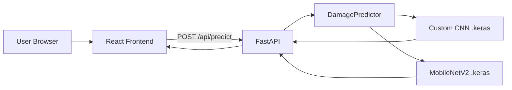
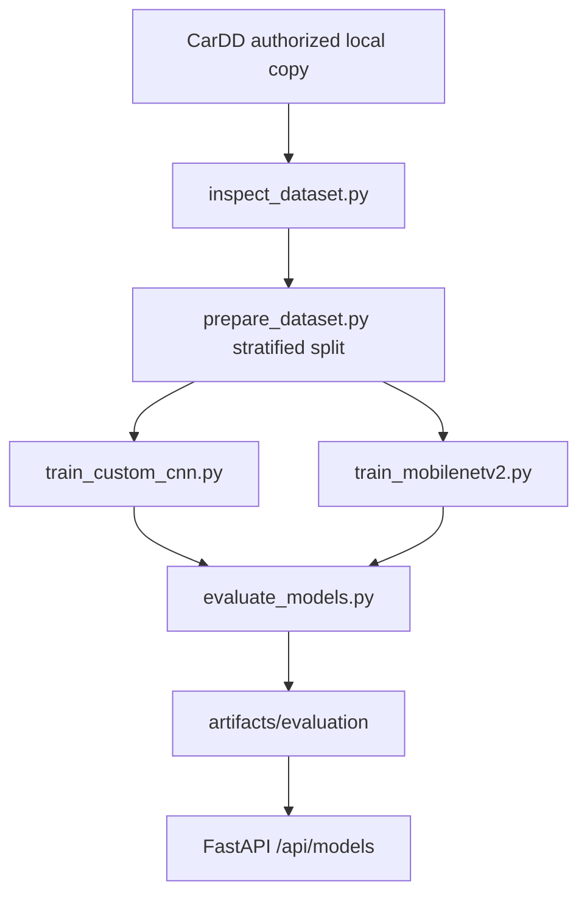

# Vehicle Damage Detection & Classification

Academic full-stack system for **vehicle damage classification** using exactly two deep-learning models on the **CarDD** dataset:

1. **Custom CNN** — TensorFlow/Keras architecture built from scratch (no pretrained backbone)
2. **MobileNetV2** — ImageNet transfer learning (freeze head → fine-tune)

> **No fake ML results.** Predictions, confidences, and metrics come only from real trained artifacts. If models are missing, the API returns a clear *model not available* response.

---

## 1. Project overview

Users upload a vehicle image, select **Custom CNN** or **MobileNetV2**, and receive a real predicted damage class with confidence, full six-class probabilities, and inference time. Comparison and Results pages load metrics from `ml/artifacts/evaluation/comparison.json`.

## 2. Problem statement

Automatic recognition of external car damage types supports insurance triage and academic study of vision models on fine-grained damage categories. Public high-quality data is limited; CarDD provides six well-defined damage classes.

## 3. Objectives

- Build a reproducible ML pipeline (inspect → prepare → train → evaluate)
- Compare a scratch CNN vs MobileNetV2 fairly on the same split
- Expose dual-model inference via FastAPI
- Present results in a professional React UI suitable for viva / AAT demo

## 4. Dataset

**CarDD** — Car Damage Detection Dataset (Wang, Li & Wu, 2023)

| Class ID | Display name |
|----------|--------------|
| `dent` | Dent |
| `scratch` | Scratch |
| `crack` | Crack |
| `glass_shatter` | Glass Shatter |
| `lamp_broken` | Lamp Broken |
| `tire_flat` | Tire Flat |

There is **no** invented “no damage” class — CarDD does not provide a genuine undamaged class.

## 5. Dataset licensing note

CarDD requires **prior consent** from the PIC Lab. Commercial use and redistribution are restricted.

- Official site: https://cardd-ustc.github.io/
- License PDF: https://cardd-ustc.github.io/docs/CarDD_license.pdf

**This repository does not include CarDD.** Do not commit the dataset to Git.

### Manual action required to obtain CarDD

1. Open https://cardd-ustc.github.io/
2. Review the license terms
3. Complete the consent/license form and email the PIC Lab contact listed on the site (historically: wangxk0624@mail.ustc.edu.cn)
4. Download the authorized archive after approval
5. Extract it locally
6. Copy `.env.example` → `.env` and set:

```env
DATASET_ROOT=./data/CarDD
```

(or any path to your extracted folder — avoid hardcoding usernames in shared configs)

7. Run `python scripts/inspect_dataset.py`

## 6. Technology stack

| Layer | Stack |
|-------|--------|
| Frontend | React, Vite, TypeScript, Tailwind CSS |
| Backend | FastAPI, Uvicorn, Pydantic |
| ML | TensorFlow/Keras, scikit-learn, Pillow |
| Viz | Matplotlib, Seaborn |
| Tests | Pytest, Vitest |

## 7. Project architecture





## 8. Custom CNN architecture

Documented in `ml/models/custom_cnn.py`:

- 4 conv blocks (32→64→128→256), each: Conv-BN-ReLU ×2 → MaxPool → Dropout
- Head: Flatten → Dense(512)-BN-ReLU-Dropout → Softmax(6)
- Trained from random initialization (no pretrained backbone)

## 9. MobileNetV2 architecture

Documented in `ml/models/mobilenetv2.py`:

- `MobileNetV2(weights="imagenet", include_top=False)`
- Head: GAP → Dropout → Dense(256) → Dropout → Softmax(6)
- Phase 1: freeze base, train head
- Phase 2: unfreeze upper layers (`fine_tune_at`), lower LR

## 10. Data preprocessing

- Image validation (format, readability, size limits)
- Resize to configurable `IMAGE_SIZE` (default 224)
- Custom CNN: scale to `[0, 1]`
- MobileNetV2: `mobilenet_v2.preprocess_input`
- Stratified train/val/test split with leakage checks
- Adapter layer auto-detects classification folders / COCO / CSV layouts **without modifying** original files

## 11. Training process

Reproducible seeds, early stopping, ReduceLROnPlateau, best-model checkpointing, history JSON/CSV.

Artifacts:

- `ml/artifacts/models/custom_cnn.keras`
- `ml/artifacts/models/mobilenetv2.keras`

## 12. Evaluation methodology

Same test split for both models. Metrics: accuracy, macro/weighted precision/recall/F1, per-class scores, confusion matrices, inference time, parameter count, file size. Figures saved under `ml/artifacts/evaluation/`.

## 13. API documentation

| Method | Path | Description |
|--------|------|-------------|
| GET | `/api/health` | Liveness + model availability (no filesystem paths) |
| GET | `/api/models` | Model status, class list, comparison payload |
| GET | `/api/comparison` | Evaluation metrics from `comparison.json` |
| POST | `/api/predict` | Multipart `file` + form `model` (`custom_cnn` \| `mobilenetv2` \| `both`) |

Interactive docs: `http://127.0.0.1:8000/docs`

Models are lazy-loaded once into a process singleton (`DamagePredictor`) — not reloaded per request.

Example single-model response:

```json
{
  "selected_model": "mobilenetv2",
  "classes": ["Dent", "Scratch", "Crack", "Glass Shatter", "Lamp Broken", "Tire Flat"],
  "prediction": {
    "model_name": "mobilenetv2",
    "class": "Dent",
    "confidence": 0.91,
    "inference_time_ms": 13.5,
    "available": true,
    "probabilities": {
      "Dent": 0.91,
      "Scratch": 0.04,
      "Crack": 0.01,
      "Glass Shatter": 0.01,
      "Lamp Broken": 0.02,
      "Tire Flat": 0.01
    }
  },
  "mobilenetv2": { "...": "same object as prediction" }
}
```

Missing selected model → HTTP **503**. Unsupported format → **415**. Oversized → **413**. Corrupt image → **400**.

## 14. Frontend architecture

| Route | Page |
|-------|------|
| `/` | Home — project intro + CTA |
| `/analyze` | Damage Analyzer — upload, model selector, live prediction |
| `/compare` | Model Comparison — table + charts from evaluation JSON |
| `/classes` | Six CarDD damage class cards |
| `/results` | Factual CNN vs MobileNetV2 result write-up |
| `/about` | Problem, methodology, stack, citation, disclaimer |

API client: `frontend/src/api/client.ts`. UI states cover loading, empty, API down, and model unavailable.

## 15. Installation (Windows 11)

### Prerequisites

- **Python 3.10–3.12 strongly recommended** (TensorFlow). Python **3.13** may work with newer TF wheels (`>=2.20`). Python **3.14** is not a reliable target for TensorFlow — use 3.12 if you see install failures.
- Node.js 18+
- Git

Full Windows notes: [`docs/SETUP_WINDOWS.md`](docs/SETUP_WINDOWS.md).

### Clone / open project

```powershell
cd "C:\path\to\Vehicle damage Detection"
copy .env.example .env
```

### Python virtual environment

```powershell
# Prefer an explicit 3.12 runtime when available:
py -3.12 -m venv .venv
.\.venv\Scripts\Activate.ps1
python -m pip install --upgrade pip certifi
pip install -r requirements.txt
```

If `pip install -r requirements.txt` fails on TensorFlow only, install core deps first, then try `pip install "tensorflow>=2.20"` (see `docs/SETUP_WINDOWS.md`).

### Frontend

```powershell
cd frontend
npm install
npm install -D vitest
copy .env.example .env
cd ..
```

## 16. Running locally

**Terminal 1 — Backend** (from project root):

```powershell
.\.venv\Scripts\Activate.ps1
uvicorn backend.app.main:app --reload --host 0.0.0.0 --port 8000
```

**Terminal 2 — Frontend:**

```powershell
cd frontend
npm run dev
```

Open http://127.0.0.1:5173

### Website usage

1. Home → **Analyze Vehicle**
2. Drag/drop an image, choose Custom CNN or MobileNetV2, click **Analyze**
3. Review predicted class, confidence, probability chart, inference time
4. Open **Comparison** / **Results** for evaluation metrics from `comparison.json`
5. Browse **Classes** for CarDD category definitions

### Model artifact locations

- `ml/artifacts/models/custom_cnn.keras`
- `ml/artifacts/models/mobilenetv2.keras`
- `ml/artifacts/evaluation/comparison.json`
- `ml/artifacts/history/*_history.json`

## 17. Training instructions

Do **not** train until authorized CarDD data is available.

```powershell
# Inspect (fails clearly if dataset missing)
python scripts/inspect_dataset.py

# Build stratified split indexes (does not modify CarDD files)
python scripts/prepare_dataset.py

# Train models
python -m ml.training.train_custom_cnn --epochs 50
python -m ml.training.train_mobilenetv2

# Evaluate + write comparison.json + figures
python -m ml.evaluation.evaluate_models
```

Optional helper:

```powershell
python scripts/run_ml.py inspect
python scripts/run_ml.py prepare
python scripts/run_ml.py train-cnn
python scripts/run_ml.py train-mobilenet
python scripts/run_ml.py evaluate
```

GPU is used automatically if TensorFlow detects one; otherwise CPU.

## 18. Testing

```powershell
# Backend + ML (venv active, from project root)
pytest -q

# Frontend logic tests
cd frontend
npm install -D vitest
npx vitest run ../tests/frontend
```

## 19. Model comparison

After evaluation, open the Comparison page or `GET /api/models`. Before training the UI shows **“Evaluation results will appear after training.”** / **“Not trained yet.”** — never placeholder metrics.

## 20. Limitations

- Classification uses a documented `max_total_area` reduction of multi-instance COCO labels (official splits preserved)
- Class imbalance (especially crack) affects per-class metrics
- Academic-scale training may overfit without sufficient data/augmentation
- Inference quality depends entirely on authorized CarDD access and training
- Web app is for local/demo deployment, not hardened multi-tenant production
- First prediction after server start may be slower while Keras models load into memory

## 21. Future improvements

- Instance segmentation / detection heads on CarDD masks
- Calibration & uncertainty estimates
- Authenticated multi-user deployment
- ONNX / TensorRT optimization for latency

## 22. Academic citation for CarDD

```bibtex
@ARTICLE{CarDD,
  author={Wang, Xinkuang and Li, Wenjing and Wu, Zhongcheng},
  journal={IEEE Transactions on Intelligent Transportation Systems},
  title={CarDD: A New Dataset for Vision-Based Car Damage Detection},
  year={2023},
  volume={24},
  number={7},
  pages={7202-7214},
  doi={10.1109/TITS.2023.3258480}
}
```

---

## Repository hygiene

Ignored by Git: `.env`, CarDD data, `*.zip`, large `.keras` weights, `node_modules`, venvs.

**Ask before pushing to GitHub.** Dataset must never be published with the repo.
