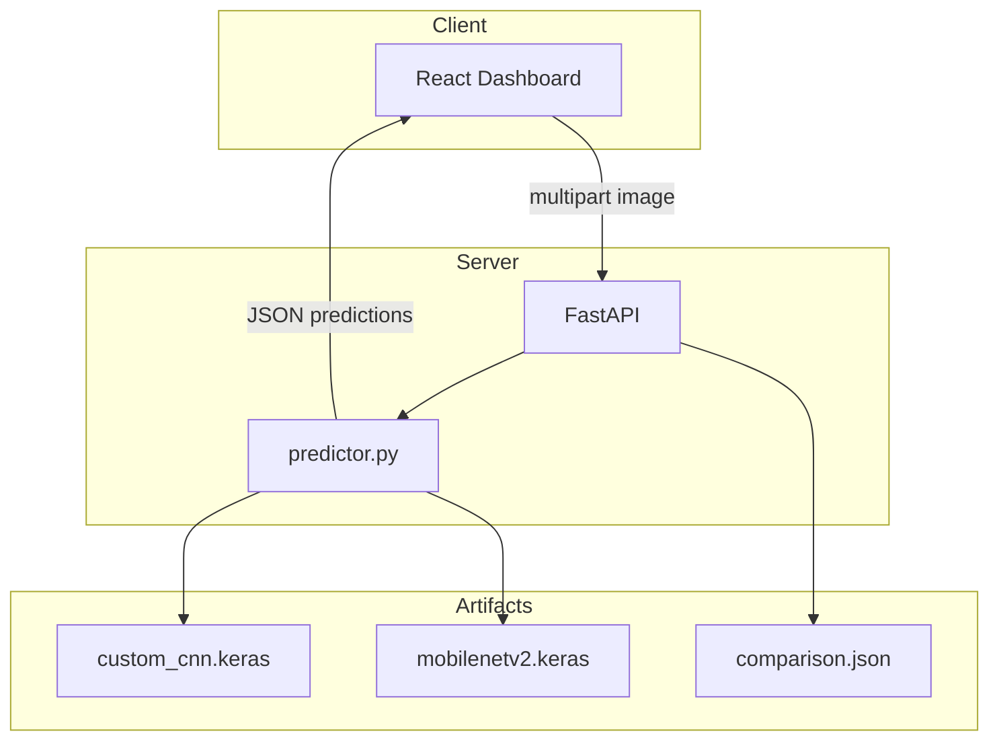

# Viva / Presentation Guide — Vehicle Damage Detection

Use this sheet to explain the project clearly during an academic viva.

## One-minute pitch

“This project is a full-stack vehicle damage classification system. A React frontend uploads a car image to a FastAPI backend, which runs **two real TensorFlow models**: a Custom CNN trained from scratch, and MobileNetV2 with ImageNet transfer learning. Both use the same CarDD classes and split for a fair comparison. We never show fake predictions—if weights are missing, the API says models are unavailable.”

## Why two models?

| | Custom CNN | MobileNetV2 |
|---|------------|-------------|
| Purpose | Baseline / explainable scratch network | Strong transfer-learning baseline |
| Weights | Random init | ImageNet |
| Strength | Full control, easy to diagram | Better features with less data |
| Weakness | Needs more data/epochs | Heavier dependency on pretrained weights |

We do **not** claim one is better until evaluation metrics are measured.

## Custom CNN (draw this)

```
Input 224×224×3
 → [Conv32-BN-ReLU ×2 → Pool → Drop] × block
 → filters 32 → 64 → 128 → 256
 → Flatten → Dense512-BN-ReLU-Drop → Softmax(6)
```

Talking points: progressive filters, BN for stable training, dropout against overfitting, softmax for multi-class probabilities.

## MobileNetV2 transfer learning

1. Freeze backbone → train head (higher LR)
2. Unfreeze upper layers → fine-tune (lower LR)

Talking points: depthwise separable convs, ImageNet features transfer to damage textures, two-phase training reduces catastrophic forgetting.

## Dataset ethics answer

“CarDD requires PIC Lab consent. We did not scrape or fabricate data. `DATASET_ROOT` is configurable. Original files are never modified; we only write split indexes and artifacts.”

## Pipeline answer

Inspect → Prepare (stratified split) → Train both → Evaluate → Serve via FastAPI → React UI.

## Demo path (if models trained)

1. Start backend + frontend
2. Show health / model status
3. Upload image → Analyze
4. Compare class, confidence, latency
5. Open Comparison page for test-set metrics

## Demo path (if models not trained yet)

1. Show UI states: model unavailable
2. Show `python scripts/inspect_dataset.py` messaging about license
3. Show code for both architectures and API contract
4. Emphasize honesty: no fabricated accuracy numbers

## Likely viva questions

**Q: How do you prevent data leakage?**  
A: Stratified split assigns each image path to exactly one of train/val/test; we assert disjoint path sets.

**Q: Why no “no damage” class?**  
A: CarDD does not provide a genuine undamaged class; inventing one would be scientifically dishonest.

**Q: How is fairness ensured?**  
A: Same classes, same split file, comparable input size, same metrics code path.

**Q: What if COCO annotations have multiple damages?**  
A: Ingestion majority-votes categories per image for classification; originals unchanged.

## Mermaid — system context


